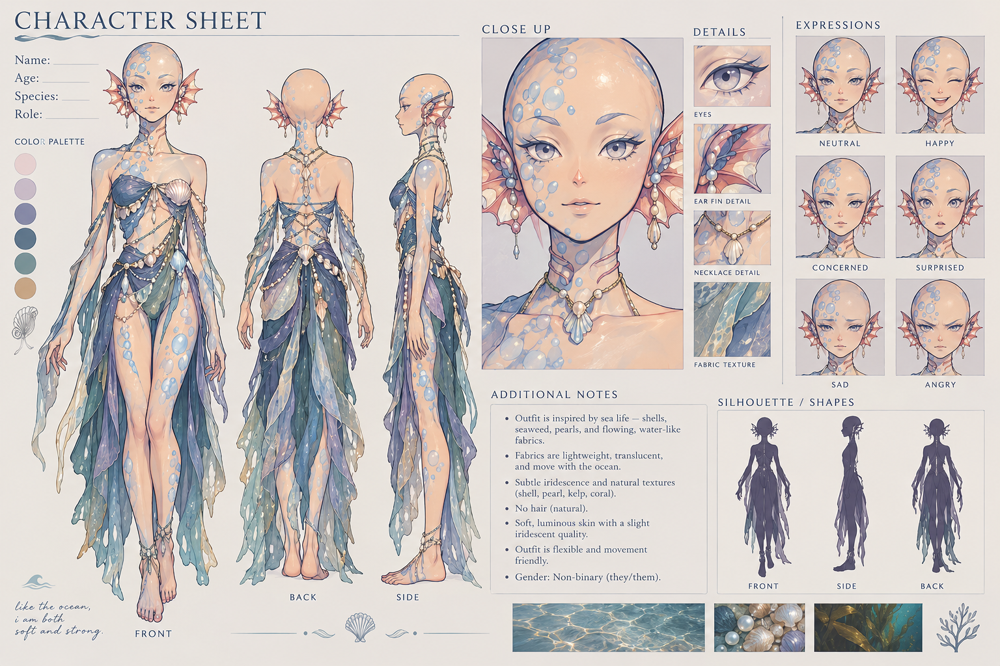

# Märchen by the Sea

A 3D third-person tide-puzzle adventure for Godot 4, by extraordinary. games.

> *like the ocean, I am both soft and strong.*

A sea-born spirit from the village under the bay goes ashore to a coast where the old fairy tales have stopped finishing. Quiet, luminous and bittersweet, in the spirit of *Nagi no Asukara*. Shift between **Soft** and **Strong**, raise and lower the tide, and carry each story to its ending.

## Design docs

| Doc | Covers |
|---|---|
| [00 · Tone and feel](docs/00-tone-and-feel.md) | The *Nagi no Asukara* feeling: what we take, what we don't, seasonal arc |
| [01 · Overview](docs/01-overview.md) | Pitch, pillars, audience, comparables |
| [02 · Character bible](docs/02-character-bible.md) | The hero: look, personality, voice, expressions, modelling brief |
| [03 · Core mechanics](docs/03-core-mechanics.md) | Soft/Strong, Breath, tide, Listen, the Unfinished, tuning numbers |
| [04 · World and narrative](docs/04-world-and-narrative.md) | The coast, five tales, endings, cast |
| [05 · Level: Nixmill](docs/05-level-nixmill.md) | Vertical-slice walkthrough |
| [06 · UI and UX](docs/06-ui-ux.md) | HUD, menus, dialogue, controls, accessibility |
| [07 · Art and audio](docs/07-art-audio.md) | Visual style, camera, music, sound |
| [08 · Roadmap](docs/08-roadmap.md) | Milestones, Godot structure, risks, open questions |

## Status

**M0: Design.** Docs in review. Next: the M1 movement prototype in Godot.
