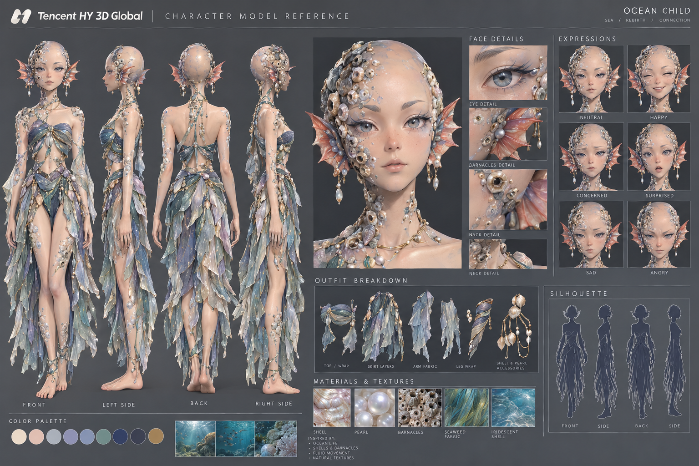

# 02 · Character bible: the hero

**Main reference:** the "Ocean Child" model reference sheet.

*Earlier concept, kept for reference:* [character_sheet_v1.png](concept/character_sheet_v1.png)

## Identity

| | |
|---|---|
| **Name** | *Working name:* **Nix**. Open question; see [08 · Roadmap](08-roadmap.md). |
| **Pronouns** | she/her |
| **Age** | Young adult |
| **Species** | Merfolk. She has legs, as on the reference sheet, on land and in water; no tail and no transformation. She swims with a strong, fluid leg kick, steering with her arms and ear fins. |
| **Role** | Newcomer to Brinehaven; hired diver |
| **Theme** | *Sea, rebirth, connection* |

## Appearance (from the v2 reference)

* **Head:** bald by nature. Large, calm grey eyes with a soft winged lash line; pale brows; small mouth; light freckles across the nose.
* **Barnacles and shells:** clusters of small barnacles, tiny shells and pearls grow across the right side of her scalp, around her face, down her neck and over her shoulders, with smaller clusters on her arms and legs. They're part of her body, not jewellery.
* **Ear fins:** coral-pink and red, webbed like a fish's fin, with pearl drop earrings hanging beneath.
* **Skin:** warm peach with a faint iridescent sheen.
* **Outfit:** a twisted top wrap and layered, ragged skirt of translucent sea-silk in lilac, periwinkle, sea green and silver; sheer arm fabric; a spiral shell leg wrap; gold chains with shells and pearls. Barefoot.
* **Palette:** cream · blush · silver-blue · lilac · periwinkle · sea green · navy · deep slate · gold.
* **Silhouette:** fins plus the long, ragged skirt.

## Barnacles: what they mean

In merfolk culture, barnacles are how a life is written on the body. A barnacle drifts through open water as a larva, then chooses one place, settles there and holds on for good.

* Merfolk grow a new barnacle when something important takes hold of them: a bond, a home, a vow, a loss.
* The cluster she arrives with is **her home**: family, her reef, her old life.
* New barnacles grow during the game as she builds a life in Brinehaven. See *Belonging* in [03 · Core mechanics](03-core-mechanics.md).
* Some humans find them strange or ugly. Some merfolk worry that her new barnacles mean she's forgetting where she came from.

## Personality

* **Hopeful and hard-working.** She came here to build something and won't give up easily.
* **Observant.** She watches before she acts; she notices how people treat each other.
* **Quietly proud** of where she comes from. She'll adapt, but she won't erase herself.
* **Homesick** more than she lets on. It surfaces in letters home and quiet moments.
* **Funny in a dry way,** especially about human habits that make no sense to her.

## Backstory

She grew up on **Coral Hollow**, a reef village far out past the islands, beyond the drop-off.

**Why she left:** Coral Hollow is dying, for two reasons.

1. **The water is warming.** For years the coral has been slowly bleaching and the fish have been leaving. Young merfolk began going to the islands to find work and send pearls home.
2. **Someone is stripping it.** Lately whole sections of the reef have been torn away in the night, faster than any warming could do. Nobody at home knows why. *(The truth: the Harbour Pearl Company has worn out the near Pearl Banks and is secretly dredging the far reefs beyond the drop-off, including Coral Hollow. She learns this during the game.)*

Her aunt Maren went to Brinehaven years ago and wrote that there was work for divers. Then the letters stopped. The hero goes to find work, send help home, and find out what happened to Maren.

**The irony at the heart of the story:** the job she takes to save her home, diving for the Company, is part of what's destroying it.

She arrives with a letter of introduction to the merfolk community, her aunt's last address, and the cluster of barnacles from home.

## Voice

* Short, plain sentences. Images from the sea. Uses merfolk words when she's emotional.
* Early in the game her human speech is careful and formal; by the end she's using dockside slang.

| Situation | Early game | Late game |
|---|---|---|
| Greeting a dockworker | "Good morning. I am looking for work, please." | "Morning, saltkin. Water's clear today." |
| Told she can't come in | "...I understand." | "I heard you. I'm still coming in." |
| Talking about home | (changes the subject) | "Let me tell you about the reef." |

## Expressions

The six expressions from the reference sheet, used in dialogue portraits and on the in-game model.

| Expression | When it's used |
|---|---|
| Neutral | Default; listening; working |
| Happy | A friend made, a good dive, a festival moment |
| Concerned | Low breath; someone in trouble; a tense meeting |
| Surprised | Discoveries; strange human customs |
| Sad | Letters from home; being turned away |
| Angry | Injustice toward the merfolk; being underpaid or insulted |

## 3D modelling brief

The v2 reference was made for 3D and is the input for building the model (artist, contractor or an image-to-3D pass such as Hunyuan 3D, with cleanup).

* **Style:** stylised anime realism, soft forms, about 7.5 heads tall.
* **Budget:** 35–50k triangles for the hero; face at least 3k.
* **Barnacles:** a separate mesh split into groups, so new clusters can be revealed as she gains belonging (see 03).
* **Rig:** standard humanoid (Godot `SkeletonProfileHumanoid`), A-pose. Extra bones for ear fins (flare when surfacing or surprised) and spring-bone chains for skirt layers and arm fabric.
* **Face:** texture swaps or blend shapes for all six expressions; a mouth shape for the surfacing breath whistle.
* **Materials:** iridescent skin; translucent sea-silk (alpha-scissor friendly); shell, pearl and barnacle with nacre sheen; gold.
* **Deliverables:** `.blend` source, `.glb` export, textures, turnaround renders.
